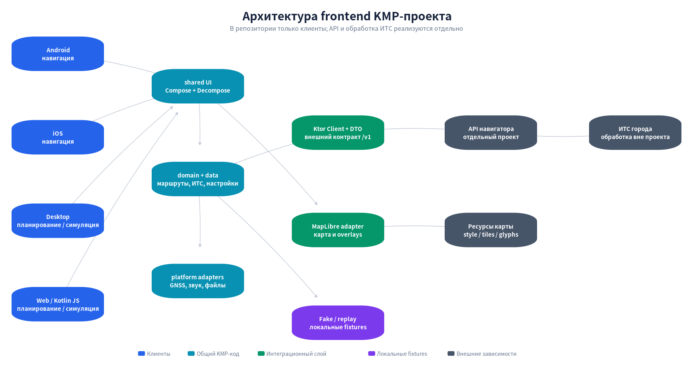
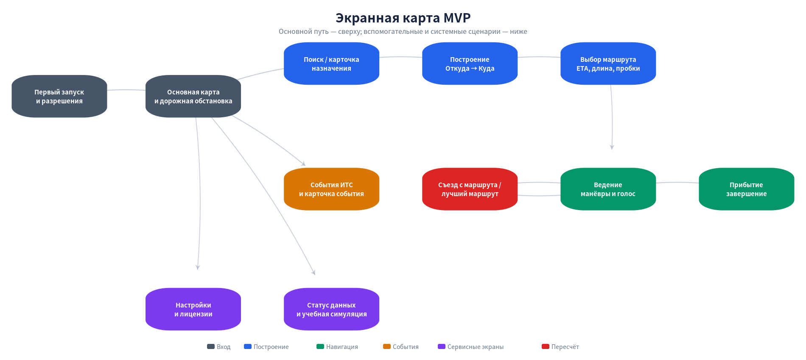

# План структуры кроссплатформенного навигатора на KMP

**Формат:** архитектурный и продуктовый план frontend MVP  
**Целевые платформы:** Android, iOS, Desktop (JVM), Web  
**Основной сценарий:** автомобильная навигация с учётом дорожной обстановки  
**Источник данных:** внешний API навигатора, реализуемый и выпускаемый отдельно  
**Дата плана:** 9 ноября 2026 года

## Резюме и рекомендуемое решение

Проект должен быть **исключительно клиентским KMP-монорепозиторием**: в нём находятся четыре приложения, общие UI- и domain-модули, сетевые клиенты, платформенные адаптеры, тесты и локальные учебные сценарии. Backend, обработка городской ИТС, хранение наблюдений, построение дорожного графа и эксплуатация маршрутизатора в этот репозиторий не входят и в план реализации не включаются. Клиент взаимодействует с уже отдельно развиваемым API навигатора через стабильные DTO и репозитории. Это разделение позволяет выпускать сервер независимо, а на frontend сохранить одинаковые экраны и пользовательские сценарии без переноса серверных моделей в приложение.

Для разработки без готового API предусматриваются `FakeRouteRepository`, `FakeTrafficRepository` и клиентский replay JSON. Они не являются backend-заглушкой, не открывают порт и не имитируют серверную инфраструктуру: это обычные реализации интерфейсов внутри приложения, возвращающие заранее записанные ответы. Рекомендуемый стек: **Kotlin Multiplatform, Compose Multiplatform, Decompose, Ktor Client, kotlinx.serialization, kotlinx.coroutines/Flow, DataStore KMP и MapLibre Compose**. Android и iOS получают реальное ведение через системную геолокацию, фоновую работу и локальный голос; Desktop и Web используют тот же UI и симуляцию. Compose Multiplatform заявляет стабильность Android, iOS и Desktop, тогда как Web остаётся Beta и требует отдельной проверки ([JetBrains](https://www.jetbrains.com/compose-multiplatform/)).

| Решение | Рекомендация | Граница ответственности |
|---|---|---|
| Состав репозитория | Только frontend/KMP и учебные fixtures | Никаких `server/`, серверных БД, миграций и городских интеграций |
| Серверный API | Внешняя версионированная зависимость `/v1` | Frontend задаёт ожидаемый контракт, но не реализует сервер |
| Карта | MapLibre Compose за собственным `MapProvider` | Клиент получает URL стиля/тайлов из конфигурации |
| Маршруты и пробки | `RouteRepository`, `TrafficRepository` | Внутреннее устройство OSRM/ИТС клиенту неизвестно |
| Локальная разработка | Fake repositories + replay | Не требуется запуск локального сервера |
| Реальное ведение | Android и iOS | Desktop/Web получают явно обозначенную симуляцию |
| Настройки и история | DataStore, локально на устройстве | Облачные аккаунты и синхронизация не входят в MVP |
| Независимость | Только разрешённые API и ресурсы карты | Публичные зарубежные карты, геолокационные SDK и облачный TTS не используются |

## 1. Границы frontend MVP

MVP должен доказать клиентский сценарий: **выбрать назначение, получить маршруты с учётом дорожной обстановки, показать ETA и свежесть данных, пройти маршрут на мобильном устройстве или воспроизвести его в симуляторе**. В frontend входят экраны, состояния загрузки и ошибок, карта, сетевой слой, локальные настройки, геолокация, манёвры, пересчёт, голос и учебные сценарии. Не входят нормализация данных ИТС, map matching датчиков, расчёт весов дорожного графа, серверный поиск адресов, хранение событий, API-аутентификация города и развёртывание инфраструктуры. Frontend показывает уже нормализованные сегменты и события, полученные от внешнего API, и не пытается самостоятельно превращать сырые показания датчиков в дорожную скорость.

Такое разделение нужно закрепить не только деревом каталогов, но и моделями. Клиент хранит `Route`, `Maneuver`, `TrafficSegment`, `RoadEvent` и `DataSourceStatus`, но не знает о детекторах, PostGIS, OSRM CSV и городских credentials. Все серверные числа сопровождаются временем измерения и признаками покрытия: приложение обязано отличать свободную дорогу от отсутствия данных. При недоступном API оно показывает offline- или stale-состояние и последний сохранённый результат с датой, но не выдаёт локальный replay за реальную дорожную обстановку. Для учебной демонстрации источник явно подписывается как «Симуляция», а production-сборка по умолчанию использует только сетевые реализации репозиториев.

| Входит в frontend | Не входит в проект |
|---|---|
| Android, iOS, Desktop и Web entry points | Ktor Server и любые server application modules |
| Compose-экраны, Decompose-компоненты, состояния UI | Обработка и хранение сырых данных ИТС |
| Ktor Client и DTO внешнего API | Реализация маршрутизации и геокодирования |
| MapLibre UI, маркеры, маршрутные линии | Генерация тайлов, дорожного графа и стилей |
| GNSS/Core Location, фоновое ведение, локальный TTS | Серверные разрешения и городские API-ключи |
| DataStore, короткая локальная история | PostgreSQL, PostGIS и миграции БД |
| Fake repositories и JSON replay | Локальный HTTP-сервер или имитация backend-инфраструктуры |

## 2. Библиотеки и платформенная матрица

Общий UI реализуется на Compose Multiplatform, экранные компоненты и навигация — на Decompose, сетевые запросы — на Ktor Client, а сериализация — на kotlinx.serialization. MapLibre Compose выбран как общая карта для Android, iOS, Desktop и Web; браузерная реализация использует MapLibre GL JS на Kotlin/JS, поскольку документация проекта не заявляет поддержку Kotlin/Wasm ([MapLibre Compose](https://maplibre.org/maplibre-compose/)). API MapLibre Compose следует изолировать за `MapHost`/`MapController`: прикладной экран работает с внутренними `GeoPoint`, `RouteLine` и `MapEventMarker`, а не с классами конкретного SDK. Это позволит обновлять библиотеку или заменять мобильный provider без изменения `RouteComponent` и доменной логики.

Российские SDK не должны становиться общей зависимостью только ради локального рынка. Yandex MapKit документируется для Android и iOS, но не закрывает Desktop и Web; 2GIS в рассмотренном варианте является Android SDK ([Yandex MapKit](https://yandex.ru/maps-api/docs/mapkit/index.html), [2GIS](https://docs.2gis.com/android/sdk/overview)). Их можно исследовать отдельно как мобильные реализации карты, однако MVP сохраняет общий MapLibre-путь. Геолокация использует Android `LocationManager` и iOS Core Location, а голос — локальный Android TTS, `AVSpeechSynthesizer` или заранее записанные русские фразы ([Android Developers](https://developer.android.com/reference/android/location/LocationManager), [Apple](https://developer.apple.com/documentation/corelocation), [Apple AVSpeech](https://developer.apple.com/documentation/avfaudio/avspeechsynthesizer)). Сторонние облачные location и speech SDK не требуются.

| Возможность | Android | iOS | Desktop JVM | Web / Kotlin JS |
|---|---|---|---|---|
| Общие Compose-экраны | P0 | P0 | P0 | P0, Beta-ограничения Web |
| Карта | MapLibre Compose | MapLibre Native через общий wrapper | MapLibre Compose | MapLibre GL JS |
| Поиск и выбор маршрута | P0 через внешний API | P0 через внешний API | P0 через внешний API | P0 через внешний API |
| Реальная позиция | `LocationManager` | `CLLocationManager` | Не требуется | Опция P1 |
| Пошаговое ведение | Реальное P0 | Реальное P0 | Симуляция P0 | Симуляция P0 |
| Фоновая работа | Foreground service | Background Location | Неприменимо | Неприменимо |
| Голос | Android TTS / аудио | AVSpeechSynthesizer / аудио | Локальные аудио при наличии | Аудио или без звука |
| Локальные настройки | DataStore | DataStore | DataStore | DataStore |
| Replay | P0 | P0 | P0 | P0 |

| Слой | Выбор | Ограничение |
|---|---|---|
| UI | Compose Multiplatform | Не помещать сетевые вызовы и подписки внутрь Composable |
| Навигация | Decompose | Общий стек экранов, без Android `Activity` в domain |
| HTTP | Ktor Client | Единые timeout, cancellation, `ApiError`, конфигурация base URL |
| DTO | kotlinx.serialization | DTO отделены от domain-моделей и версионируются |
| Асинхронность | Coroutines + Flow | Один state holder на экран; structured concurrency |
| Настройки | DataStore KMP | SQLDelight/Room только при появлении сложной локальной истории |
| Карта | MapLibre Compose | Версии зафиксированы, SDK скрыт за внутренним контрактом |
| Мобильная геолокация | Системные API | Разрешения и точность отображаются в общий `LocationPermission` |
| Голос | Системный TTS / bundled audio | Облачный TTS не является зависимостью |

## 3. Архитектура frontend и внешние зависимости

На архитектурной схеме всё внешнее вынесено за границу репозитория. Внутри находятся четыре entry points, общие экраны, domain/data и платформенные адаптеры. Снаружи расположены **API навигатора**, **ресурсы карты** и городская ИТС как источник, обрабатываемый отдельной командой. Frontend общается с ними только по HTTP/HTTPS и конфигурационным URL. Он не содержит серверных реализаций и не должен запускаться обязательным скриптом вместе с backend. Для unit/UI-тестов и учебной демонстрации сетевые репозитории заменяются локальными fake-реализациями, поэтому разработка UI не блокируется выпуском серверной версии.

Пользовательский запрос проходит путь `Screen → Component → UseCase → Repository → External API`, после чего DTO преобразуются в domain-модели и неизменяемый UI-state. Потоки геолокации и дорожных событий объединяются только в навигационном компоненте. При выходе с экрана поиска запрос отменяется, при остановке ведения прекращаются геолокация и голос, а новый расчёт отменяет устаревший. `MapProvider` отвечает только за визуализацию и жесты; он не решает, когда нужен пересчёт. `LocationProvider` выдаёт позицию, но не вызывает API напрямую. Такие границы позволяют тестировать большую часть frontend на JVM без устройства и без сети.



| Поток | Участники frontend | Внешняя зависимость | Результат |
|---|---|---|---|
| Поиск | SearchComponent → SearchRepository → Ktor Client | `/v1/search` | Список адресов, empty/error/offline |
| Построение | RouteComponent → RouteRepository | `/v1/routes` | Альтернативы, геометрия, манёвры, ETA, freshness |
| Пробки | TrafficRepository → Flow/state | `/v1/traffic` | Скорости, покрытие, срок действия |
| События | EventsRepository → карта/карточка | `/v1/events` | Активные события и их атрибуты |
| Ведение | LocationProvider → GuidanceEngine → VoiceGuider | API только при пересчёте | Манёвры, остаток, off-route, прибытие |
| Симуляция | SimulationController + Fake repositories | Не требуется | Пауза, скорость, съезд, stale-сценарий |
| Ресурсы карты | MapHost → style/tile loader | Настроенные style/tile/glyph URLs | Карта без обращения к публичным чужим tiles |
| Диагностика | HealthRepository → экран статуса | `/v1/health` | Последнее обновление и доступность данных |

## 4. Экраны и пользовательские сценарии

Экранная карта строится вокруг пути «карта → поиск → построение → выбор маршрута → ведение → прибытие». Первый запуск на Android и iOS объясняет геолокацию, но всегда оставляет ручной выбор начала маршрута. Desktop и Web вместо реального ведения запускают явно обозначенную симуляцию. Дополнительные экраны событий, настроек, статуса данных и лицензий доступны с главной карты, но не перегружают основной сценарий. Все двенадцать экранов используют общие Decompose-компоненты; отличаются только layout, жесты и доступные аппаратные действия. Состояния ошибок являются частью соответствующего экрана, а не отдельными техническими страницами.

Экран статуса особенно важен для учебного продукта: он показывает, когда внешний API последний раз сообщал успешное обновление, какие данные устарели и работает ли текущий режим на replay. Пользователь не должен принимать неизвестную скорость за отсутствие пробки. При потере позиции маршрут сохраняется, при отказе в разрешении доступен ручной старт, а при отсутствии сети последний результат помечается датой. На мобильных платформах экран ведения управляет фоновым жизненным циклом, на Desktop/Web те же состояния проверяются через `SimulationController`. Карточка «О программе» содержит attribution OpenStreetMap и лицензии используемых ресурсов ([OpenStreetMap](https://www.openstreetmap.org/copyright)).



| № | Экран P0 | Содержимое | Действия и состояния |
|---:|---|---|---|
| 1 | Первый запуск и разрешения | Назначение геолокации, приватность, ручной старт | Разрешить, продолжить без неё; точная/ограниченная точность, отказ |
| 2 | Основная карта | Позиция, маршрут, пробки, события, поиск | Выбор точки, открытие сервисных экранов; loading/offline/stale |
| 3 | Поиск назначения | Строка, локальная история, результаты API | Ввод, отмена запроса, выбор; empty/error/offline |
| 4 | Карточка точки | Адрес, координаты, соседние события | Сделать стартом/финишем, сохранить локально |
| 5 | Построение маршрута | Откуда, куда, опции, учебный сценарий | Поменять точки, рассчитать; валидация ввода |
| 6 | Предпросмотр | Альтернативы, ETA, длина, пробки, время данных | Выбрать, начать ведение/симуляцию; no route |
| 7 | Активное ведение | Следующий манёвр, остаток, ETA, mute | Завершить, пересчитать; GNSS lost/off-route/stale |
| 8 | Прибытие | Завершение и учебная сводка | Повторить, вернуться на карту |
| 9 | Событие ИТС | Тип, серьёзность, срок действия, описание | Показать на карте, пересчитать; expired/incomplete |
| 10 | Настройки | Голос, единицы, симуляция, пороги UX | Сохранить локально, сбросить; TTS unavailable |
| 11 | Статус и симуляция | Freshness, coverage, ошибки API, replay | Play/pause/speed, вызвать съезд/устаревание |
| 12 | О программе | Версия, режим данных, attribution, лицензии | Offline-просмотр встроенных текстов |

| Системное состояние | Поведение frontend |
|---|---|
| Разрешение отклонено | Не зацикливать запрос; предложить ручной старт |
| Ограниченная точность | Показывать неопределённость и не имитировать уверенный манёвр |
| Позиция потеряна | Сохранить маршрут, приостановить guidance, предложить симуляцию |
| Данные ИТС устарели | Пометить ETA и скорости; не называть их текущими |
| Нет покрытия | Отображать unknown, а не зелёный цвет |
| Маршрут не найден | Показать безопасное сообщение API и действие повтор/изменить точки |
| Съезд с маршрута | Запросить новый маршрут после устойчивого отклонения |
| Найден лучший путь | Предложить изменение, не переключать молча |
| Offline | Показать последний результат с датой; replay отдельно обозначен |
| Прибытие | Остановить GNSS, фоновую работу и голос |

## 5. Модули и зависимости

Репозиторий разделяется на runnable applications и shared libraries, как рекомендует современная структура KMP с отдельными приложениями и общими модулями ([JetBrains](https://blog.jetbrains.com/kotlin/2026/05/new-kmp-default-structure/)). В `core` находятся только клиентские модели и DTO; `shared:domain` не зависит от Compose и Ktor; `shared:data` реализует репозитории; `shared:ui` отображает состояния. Ни одного серверного каталога в дереве нет. iOS подключается через Kotlin/Native targets и Xcode entry, Android содержит системные сервисы, Desktop и Web получают собственные entry points. Локальные fixtures лежат в `testFixtures` или ресурсах demo-сборки и не смешиваются с production-конфигурацией.

Зависимости направлены к domain: `ui → domain`, `data → domain`, `platform app → shared`, но не наоборот. Внешний API рассматривается как контракт, а не как исходный код. Для parallel development используется checked-in набор JSON-примеров ответов и `ApiFixtures`, но не локальный сервер. `BuildConfig`/desktop properties/web config содержат `apiBaseUrl`, `mapStyleUrl` и feature flag `demoMode`. Секреты, если однажды понадобятся для пользовательского API, не зашиваются в общий код; учебный MVP предпочитает публичный внутренний контур без встроенных городских ключей. Доступ к серверным credentials вообще отсутствует у frontend-команды по модели проекта.

```text
root/
├── build-logic/               # общие Gradle-конвенции клиентских модулей
├── core/
│   ├── model/                 # GeoPoint, Route, Maneuver, TrafficSegment, RoadEvent
│   └── api/                   # DTO /v1, ApiError, serialization
├── app/
│   ├── shared/
│   │   ├── domain/            # use cases, repositories, GuidanceEngine, политики UX
│   │   ├── data/              # Ktor Client, repositories, DataStore, DTO mapping
│   │   ├── ui/                # Compose-экраны и состояния
│   │   ├── navigation/        # Decompose root и screen components
│   │   └── map/               # MapHost, MapController, MapLibre adapter
│   ├── androidApp/            # Activity, GNSS, permissions, service, TTS
│   ├── iosApp/                # Xcode, Core Location, background, AVSpeech
│   ├── desktopApp/            # JVM window и replay controls
│   └── webApp/                # Kotlin/JS entry и MapLibre GL JS
├── testFixtures/
│   ├── routes/                # записанные ответы маршрутов
│   ├── traffic/               # свежие, устаревшие и неполные данные
│   └── scenarios/             # съезд, ДТП, offline, прибытие
└── config/
    ├── demo/                  # локальные fake/replay настройки
    └── production/            # только внешние base URLs, без серверного кода
```

| Модуль | Содержит | Не содержит |
|---|---|---|
| `core:model` | Domain-типы и value objects | Compose, Android/iOS API, серверные сущности |
| `core:api` | DTO и контрактные примеры | Реализацию API и бизнес-расчёт сервера |
| `shared:domain` | Use cases, interfaces, guidance state machine | HTTP, платформенные разрешения |
| `shared:data` | Ktor Client, repositories, DataStore, fake data | Composable и городские парсеры |
| `shared:ui` | Экраны и UI-state | `LocationManager`, `CLLocationManager` |
| `shared:navigation` | Decompose-стек | Сетевые вызовы |
| `shared:map` | Внутренний map contract и MapLibre adapter | Политику пересчёта |
| `androidApp` | Геолокация, service, permissions, TTS | Отдельную маршрутную логику |
| `iosApp` | Core Location, background, audio, TTS | Отдельную guidance state machine |
| `desktopApp` / `webApp` | Entry и симуляцию | Притворную реальную GNSS-навигацию |

```kotlin
interface RouteRepository {
    suspend fun routes(request: RouteRequest): RouteResult
}

interface TrafficRepository {
    fun observeSegments(bounds: GeoBounds): Flow<List<TrafficSegment>>
    fun observeEvents(bounds: GeoBounds): Flow<List<RoadEvent>>
}

interface LocationProvider {
    val samples: Flow<LocationSample>
    suspend fun start()
    suspend fun stop()
}

interface VoiceGuider {
    suspend fun speak(instruction: VoiceInstruction)
    suspend fun stop()
}

interface SimulationController {
    val state: Flow<SimulationState>
    fun play(speed: Double)
    fun pause()
    fun seek(progress: Double)
    fun triggerOffRoute(offsetMeters: Double)
}
```

Сетевые `KtorRouteRepository` и `KtorTrafficRepository` используются в production, а `FakeRouteRepository` и `ReplayTrafficRepository` — в demo и тестах. Оба набора возвращают одинаковые domain-результаты и одинаково отображают ошибки. Fake-режим не скрывается: на карте и экране статуса есть метка «Учебные данные». Переключение выполняется через DI при создании `RootComponent`, без разбросанных `if (demo)` по экранам. Благодаря этому изменение внешнего API затрагивает `core:api`, DTO mapper и сетевые repositories, но не требует переписывания UI или платформенной навигации.

## 6. Контракт с отдельным backend

Frontend-команда фиксирует ожидаемый контракт, но не реализует его. Минимальный набор endpoints сохраняется как интеграционное требование к отдельному серверному проекту. Ответы должны содержать уже подготовленную геометрию, манёвры и нормализованные дорожные данные; сырые пакеты ИТС клиенту не нужны. Для совместимости используется `/v1`, `requestId`, типизированные ошибки и поля времени. API не должен требовать аккаунт в MVP, а route request содержит только координаты и опции. Desktop, Web, Android и iOS используют одинаковые DTO, поэтому отсутствие синхронного обновления сервера не должно ломать старые клиенты.

Контрактные примеры JSON хранятся в `testFixtures` и проигрываются в тестах парсера. Они не описывают внутреннюю серверную реализацию и не превращаются в самодостаточный mock server. При изменении API сначала обновляется пример, затем проверяются все клиентские мапперы. Необязательные поля не должны приводить к неопределённому UI: для `speedKph = null` отображается unknown, для отсутствующего `sampledAt` — неизвестное время, для пустого списка альтернатив — состояние no routes. Поле `mode = LIVE | REPLAY` в локальном UI-state сообщает происхождение данных, но сервер не обязан знать о клиентском replay.

| Endpoint внешнего API | Что нужно frontend | Использование |
|---|---|---|
| `POST /v1/routes` | start, destination, options | Маршруты, geometry, maneuvers, distance, duration, ETA, `trafficData` |
| `GET /v1/search` | query, bounds, `lang=ru` | Адресные результаты и координаты |
| `GET /v1/reverse` | lat, lon | Отображаемый адрес точки |
| `GET /v1/traffic` | bounds, optional `since` | Сегменты, скорости, freshness, confidence, coverage |
| `GET /v1/events` | bounds, activeAt | События, геометрия, severity, validity |
| `GET /v1/health` | Нет пользовательских данных | Статус и время последнего обновления |

| Общая модель ответа | Обязательные поля для UI |
|---|---|
| `Route` | id, geometry, maneuvers, distanceMeters, durationSeconds, trafficSampledAt |
| `Maneuver` | type, location, instruction, distanceToNextMeters |
| `TrafficSegment` | segmentId, geometry/reference, speedKph?, sampledAt?, expiresAt?, coverage |
| `RoadEvent` | id, type, geometry, severity, validFrom, validTo?, description? |
| `DataSourceStatus` | lastSuccessAt?, freshness, coverageRatio?, safeErrorMessage? |
| `ApiError` | type, message, requestId, retryable |

## 7. Мобильные адаптеры и независимость

Android реализует геолокацию через системный `LocationManager`, foreground service на время активного маршрута и локальный TTS. iOS использует Core Location, background location только во время ведения и `AVSpeechSynthesizer`; обновления прекращаются при прибытии или отмене ([Apple Background Location](https://developer.apple.com/documentation/corelocation/handling-location-updates-in-the-background)). Общий `LocationPermission` включает `GrantedPrecise`, `GrantedApproximate`, `Denied`, `Restricted` и `NotRequired`. На Desktop/Web эти адаптеры заменяются симулятором. Внешний API и ресурсы карты задаются конфигурацией; публичные зарубежные tile/geocoding services, fused location SDK и облачный TTS не являются обязательными runtime-зависимостями.

Независимость проверяется фактическими сетевыми вызовами, а не только списком библиотек. В style JSON не должно быть незадекларированных URL глифов, спрайтов и тайлов. Приложение обращается только к разрешённым hosts, а тестовый запуск с заблокированной внешней сетью сохраняет replay и заранее доступные ресурсы. Локальная история, настройки и последний маршрут хранятся на устройстве; серверная история и рекламная аналитика отсутствуют. Точные траектории по умолчанию не пишутся в логи. Attribution OpenStreetMap и лицензии картографических ресурсов доступны в приложении, а использование публичных OSM tiles для production/offline не планируется ([OSMF Tile Policy](https://operations.osmfoundation.org/policies/tiles/)).

| Область | Требование | Проверка |
|---|---|---|
| Сетевые hosts | Только внешний API проекта и настроенные map resources | Сетевой аудит всех четырёх клиентов |
| Геолокация | Системные Android/iOS API | Работа без стороннего location SDK |
| Голос | Локальный TTS или bundled audio | Подсказки доступны без облачного speech API |
| История | Локально через DataStore | В route request нет истории и идентификатора пользователя |
| Логи | Без точных траекторий по умолчанию | Проверка logcat, Xcode Console и Web logs |
| Лицензии | OSM attribution и реестр ресурсов | Экран «О программе» доступен offline |
| Demo | Только явно обозначенные fake/replay | Невозможно принять учебные данные за LIVE |
| Секреты | Городских credentials нет в клиенте | Проверка APK, iOS/Desktop/Web bundles |

## 8. Этапы реализации frontend

Ориентировочный план занимает **10–14 недель для команды из 3–5 разработчиков**, поскольку серверная реализация, хранение и обработка ИТС исключены. Нужны координация контракта и доступ к тестовому внешнему API, но начальный UI можно строить на fixtures. Для iOS с первого этапа требуются macOS, Xcode и реальные устройства; для Web — ранняя проверка Kotlin/JS-карты. Каждый этап заканчивается запускаемым клиентским срезом. При задержке отдельного backend команда продолжает работу на fake repositories, однако интеграционная приёмка LIVE-режима не объявляется завершённой до подключения настоящего API.

Приоритет отдаётся ранним техническим рискам: четырёхплатформенная карта, единый UI, затем сетевые контракты и мобильное ведение. В план не включаются серверное развёртывание, городская интеграция и настройка маршрутизатора. Если внешний API меняется, frontend изолирует изменения в DTO и repositories. Если MapLibre на одной из платформ показывает критические ограничения, заменяется только map adapter. При нехватке времени сокращаются визуальные улучшения и дополнительные сценарии, но не удаляются offline/stale-состояния, безопасность геолокации и различие LIVE/REPLAY.

| Этап | Срок | Работы | Результат |
|---|---:|---|---|
| 0. UX и API-контракт | 1–2 недели | Wireframes, состояния, DTO, fixtures, требования к map resources | Утверждены экраны, JSON-примеры и граница frontend/API |
| 1. KMP-каркас и карта | 2–3 недели | Модули, Compose, Decompose, MapProvider, Android/iOS/Desktop/Web entries, CI | Четыре приложения показывают карту из настроенных ресурсов |
| 2. Поиск и маршруты | 2 недели | Ktor Client, repositories, экраны поиска/построения/предпросмотра | Основной путь работает на fake и тестовом LIVE API |
| 3. Пробки, события, replay | 1–2 недели | Traffic/events states, freshness, статус, SimulationController | Пользователь видит LIVE/REPLAY, stale, unknown и события |
| 4. Мобильное ведение | 2–3 недели | Android/iOS location, background, TTS, манёвры, off-route | Тестовые поездки и Desktop/Web-симуляция проходят сценарии |
| 5. Стабилизация | 1–2 недели | UI/offline tests, accessibility, сетевой аудит, лицензии, документация | Все frontend acceptance tests выполнены без server-кода в репозитории |

| Входит в MVP | После MVP |
|---|---|
| Четыре клиента и общие экраны | Полный offline-пакет региона |
| Внешние route/search/traffic/events API | Браузерная геолокация |
| Android/iOS guidance и локальный голос | Аккаунты и синхронизация |
| Desktop/Web simulation | Сложная локальная БД истории |
| Fake fixtures для разработки | Дополнительные виды транспорта |
| Freshness/coverage и диагностика | Расширенная аналитика поездок |

## 9. Тестирование и критерии приёмки

Тесты frontend делятся на доменные, контрактные, компонентные, UI и платформенные. Доменные проверяют выбор манёвра, гистерезис съезда, прибытие и freshness без сети. Контрактные читают JSON fixtures и подтверждают, что nullable/unknown поля превращаются в правильные состояния. Repository-тесты используют Ktor MockEngine или fake HTTP-движок внутри теста, а не отдельный серверный модуль. Compose/Decompose-тесты проверяют навигацию и сохранение состояния. На Android и iOS обязательны реальные устройства для геолокации, фонового режима и звука; Desktop/Web проходят одинаковые replay-сценарии. Для интеграции с внешним API выделяется отдельный test environment, управляемый его владельцем.

Приёмка MVP означает, что клиенты можно собрать и запустить без checkout или сборки backend-репозитория. Demo-сценарии работают локально, LIVE-сценарии используют настроенный base URL. Сетевой аудит включает карту, стиль, глифы и спрайты, а не только Ktor Client. При сворачивании мобильного приложения навигация ведёт себя согласно платформенным правилам, а после завершения маршрута обновления прекращаются. Изменение серверного DTO обнаруживается контрактными тестами. Числовые бюджеты памяти, скорости запуска и энергопотребления фиксируются после первых измерений на выбранных устройствах, а не задаются как неподтверждённые универсальные обещания.

| Приёмочный сценарий | Ожидаемый результат |
|---|---|
| Сборка репозитория | Нет server-модулей, БД, миграций и обязательного локального API |
| Demo без сети | Fake/replay сценарии работают и явно подписаны как учебные |
| LIVE-подключение | Смена base URL подключает внешний API без изменения UI/domain |
| Поиск и маршрут | Основной путь проходит на четырёх платформах; ошибки имеют понятное действие |
| Stale/unknown | Устаревшие и непокрытые данные визуально отличаются от свободной дороги |
| Отказ геолокации | Ручной старт остаётся доступен; запрос разрешения не зацикливается |
| Фоновое ведение | Android/iOS сохраняют активный маршрут и останавливают обновления после него |
| Съезд и лучший путь | Пересчёт контролируемый; лучший маршрут предлагается, а не включается молча |
| Offline | Последний результат имеет дату; новый LIVE-расчёт не имитируется |
| Прибытие | Guidance, геолокация, фоновая работа и звук остановлены |
| Сетевая независимость | Нет незадекларированных внешних runtime endpoints |
| Совместимость | Все клиенты читают общие `/v1` fixtures и дают согласованные domain-состояния |

| Риск | Митигация |
|---|---|
| Отдельный API меняет контракт без предупреждения | `/v1`, JSON fixtures, контрактные тесты и совместный release checklist |
| LIVE API ещё не готов | Fake repositories; не объявлять интеграцию завершённой по demo |
| MapLibre отличается на платформах | Ранний spike, зафиксированные версии, внутренний `MapProvider` |
| Web/Wasm несовместимость | Web остаётся на Kotlin/JS |
| iOS теряет фоновые обновления | Правильные capabilities, обновления только при активном маршруте, полевые тесты |
| Replay принимают за реальные пробки | Явные LIVE/REPLAY-индикаторы на карте и статусе |
| Внешние ресурсы скрыты в style JSON | Allowlist hosts и сетевой аудит карты |
| Frontend начинает дублировать серверные расчёты | Запрет сырых ИТС-моделей и маршрутизатора в клиентских модулях |

## 10. Итоговая структура поставки

Поставкой этого проекта являются **Android, iOS, Desktop и Web приложения, общие KMP-библиотеки, конфигурация внешних endpoints, локальные fixtures и тесты**. Отдельный backend упоминается только как интеграционная зависимость: его исходный код, Dockerfile, базы данных, маршрутизатор, городские адаптеры и эксплуатационные скрипты сюда не добавляются. README frontend должен содержать два независимых запуска: demo без сети и LIVE с предоставленными владельцем API адресами. Настройка и выпуск сервера остаются в его собственном проекте и не являются шагами сборки клиентов.

Практический порядок начала работы: утвердить DTO и экранные состояния, проверить MapLibre на четырёх платформах, собрать поиск и маршрут на fake repositories, затем подключить тестовый LIVE API и реализовать мобильное ведение. Важнейший архитектурный запрет — не переносить серверные функции в клиент ради временного удобства. Если backend задерживается, frontend продолжает развиваться на fixtures; если API меняется, обновляется только интеграционный слой. Такой подход сохраняет преимущества KMP и даёт командам независимые релизные циклы без скрытой связанности репозиториев.

| Артефакт | Принадлежность |
|---|---|
| KMP UI, domain, data, map | Этот frontend-проект |
| Android/iOS/Desktop/Web applications | Этот frontend-проект |
| DTO, API client, fixtures | Этот frontend-проект |
| Реализация `/v1` | Отдельный backend-проект |
| Обработка ИТС и маршрутизация | Отдельный backend-проект |
| Базы, миграции, серверное развёртывание | Отдельный backend-проект |
| Тестовый LIVE endpoint и его эксплуатация | Владелец отдельного backend-проекта |

*Правовые и лицензионные замечания приведены для общего информирования и не заменяют консультацию юриста по конкретным картографическим данным, OpenStreetMap и условиям использования внешнего API.*
